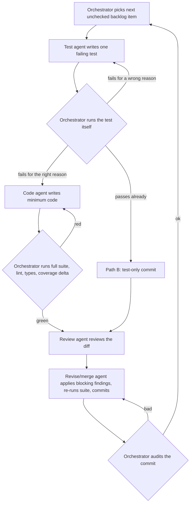

# Blue Marble Mixtape: Orchestration and Design Plan

Status: **approved by the owner on 2026-11-14**. Progress lives in `docs/BACKLOG.md` and the git history.
Written: 2026-11-14.

This file is the single source of truth. Any orchestrator on any platform (Claude Code, Codex, or another agent runner) can read it, read `docs/BACKLOG.md`, and resume the work with no other context. Section 12 says exactly how.

---

## 1. What we are building

A public website: a side-scrolling, 8-bit, tile-based platform game that is a museum. Each room is an exhibit of NASA Earth Information Center (EIC) graphics. The visitor walks up to a glowing artifact, answers a yes/no prompt with the up and down arrows, and then sees the artifact magnified while a sonification of it plays, with a moving marker showing which part of the picture is sounding.

Source: <https://svs.gsfc.nasa.gov/gallery/earth-information-center/> and every page it links to, recursively.

### Decisions already made by the owner

| Topic | Decision |
| --- | --- |
| Controls | The four arrow keys only. Left and right walk and change values. Up means yes, down means no, and they do nothing else. No jumping, no dropping, no Y or N keys. |
| Mobile input | Four on-screen arrow buttons on touch devices: left and right under the left thumb, up (yes) and down (no) under the right. They fire the same four actions as the keyboard. |
| Palette | Dusk: dark navy backdrop, cream text, gold and coral accents. |
| Identity | The cassette is the main visual motif on every screen, not a decoration. On the title screen the Earth sits alone in the centre of the cassette. |
| Avatar | The visitor customises their explorer before the tutorial. |
| Backgrounds | Each room's background is detailed and built for its theme, but calm: low contrast, little motion, never competing with artifacts or text (§6). |
| Listening view | The real NASA image at full resolution, with its date. |
| Final exhibit authoring | Arrow-driven rule builder. No typing. |
| Final exhibit artifact | Chosen from the catalogued NASA library. No uploads. |
| Exhibit grouping | 9 theme rooms (the nine EIC themes) plus the build-your-own lab as room 10. |
| Azure | Static Web Apps (Free plan) on an Azure for Students subscription. No Blob Storage, Functions, or Azure AI. |
| Repository | New public GitHub repository, fresh code. The existing `eic-audio-gallery` folder is reference only; no code is copied from it. |
| After this plan | Stop for owner review. |

### Requirement traceability

Every requirement has an automated check. A requirement with no check is not done.

| Requirement | Where it is designed | Enforced by |
| --- | --- | --- |
| Four agents with fixed models, plus orchestrator | §2, §3 | Role files in `docs/agents/`; orchestrator checklist |
| Platform agnostic | §12 | Plain Markdown state; no platform-specific tool names in role files |
| All graphics from source, nested links followed | §5 | Ingest tests against recorded API fixtures; catalog completeness test |
| Different algorithm and instruments per exhibit | §7 | Uniqueness test on room recipes; audio-feature distance test |
| Public virtual museum | §9 | Deploy workflow; smoke test against the preview URL |
| 8-bit platformer style, mobile compatible | §6 | Indexed-framebuffer golden tests; Playwright mobile viewports |
| Strict TDD per commit, review, revise, commit | §3 | Red/green evidence gates; coverage-delta check; linter, style checker, and mutation testing |
| One-line past-tense commits, no agent, owner as author | §4 | `commit-msg` hook; CI history audit |
| Never push to mainline | §4 | `pre-push` hook; GitHub branch protection |
| Already-passing test committed separately | §3, path B | Orchestrator gate |
| PR for manual review | §4, §10 | Draft PR opened at first deploy |
| Alt text on all images | §8 | Catalog test; axe-core in Playwright |
| Large, minimal text | §8 | String budget test |
| Keyboard only: the four arrow keys, up for yes and down for no (the owner replaced y/n and removed jump and drop) | §6, §8 | Input-map test; end-to-end flows driven only by those keys |
| Screen flow Welcome → Avatar → Tutorial → rooms → lab | §6 | State-machine tests; end-to-end walkthrough |
| Glowing artifacts, yes/no prompt, magnified view, playhead | §6, §7 | Renderer golden tests; score-cursor tests |
| Tailored, detailed, but calm background per exhibit | §6 | Background spec tests: motif list, backdrop-palette, contrast, and motion limits |
| Real NASA image at full resolution with its date | §5, §6 | Catalog test for full-resolution URL and date; viewer end-to-end test |
| Uses Microsoft Azure | §9 | Deploy workflow test; live smoke test |

---

## 2. Agents

Five roles. The orchestrator is the main session. The other four are stateless workers: each call receives a complete work order and returns a structured report. A worker never relies on memory of an earlier call.

| Role | Model | Effort | May write | Must not |
| --- | --- | --- | --- | --- |
| Orchestrator | Main session model | n/a | `docs/**` only | Write product code or tests; commit |
| Test agent | Sonnet 5 family | medium | `tests/**`, `e2e/**`, test fixtures | Touch `src/**`; commit |
| Code agent | Sonnet 5 family | medium | `src/**`, `tools/**`, build and CI config | Touch tests; commit |
| Review agent | Opus 5 family | medium | Nothing (read-only) | Edit any file |
| Revise/merge agent | Sonnet 5 family | medium | Anything a review finding names; `docs/BACKLOG.md` tick; the commit | Push; weaken or delete an assertion; add unreviewed behaviour |

"Sonnet 5 family" and "Opus 5 family" mean the newest release in that line that the platform offers. On a platform without these models, use its closest tiers: a mid-tier coding model for test, code, and merge, and its strongest reasoning model for review. Record the substitution in `docs/DECISIONS.md`.

Only one agent writes to the working tree at a time. There is no parallel writing; history stays linear.

### Work order (orchestrator → worker)

```
ITEM:        <backlog id and one-sentence behaviour>
ROLE:        test | code | review | merge
CONTEXT:     <files to read first; relevant §s of this plan>
ALLOWED:     <path globs this call may write>
INPUT:       <for code: the failing test and its output; for review: the diff;
              for merge: the review findings>
COMMANDS:    npm test -- <filter> ; npm run check
RETURN:      the report block for this role, nothing else
```

### Report blocks (worker → orchestrator)

- **Test**: `STATUS: RED | GREEN_ON_ARRIVAL | BLOCKED`, test file and name, the exact failure output, and why that failure means the behaviour is missing.
- **Code**: `STATUS: GREEN | TEST_DEFECT | BLOCKED`, files changed, full-suite result, one line on why this is the minimum.
- **Review**: `VERDICT: APPROVE | REQUEST_CHANGES`, numbered findings, each tagged `blocking` or `note`, each with file and line.
- **Merge**: `STATUS: COMMITTED | BLOCKED`, findings addressed by number, full-suite result, commit hash, commit subject.

---

## 3. The TDD cycle (one cycle = one backlog item = one commit)



Gates the orchestrator checks itself, never taking a worker's word:

1. **Red is real.** The orchestrator runs the new test and sees it fail. A syntax error, a typo, or a broken import inside the test is a wrong reason. A missing module or function that the item is supposed to create is a right reason.
2. **Green is real.** Full suite passes, and so does `npm run check`: the linter (ESLint), the style checker (Prettier), and the type checker.
3. **Minimum code.** Every line added under `src/` is executed by a test (coverage delta). An uncovered new line is a blocking finding. The reviewer also rejects options, parameters, and branches that no test demands.
4. **Mutants die.** Mutation testing (StrykerJS) runs on the product files the item changed. A surviving mutant that the item's behaviour should catch sends the item back to the test agent. CI runs mutation testing in full and fails below a score of 80.
5. **Review happened.** The review report exists and every blocking finding is addressed by number in the merge report.
6. **Commit is clean.** See §4.

**Path B, test passes on arrival.** If a new test passes because earlier minimum code already covers it, the code agent is skipped. The test agent must show the test can fail by describing one mutation of `src/` that turns it red; the orchestrator applies that mutation, confirms red, and reverts it. The test then goes through review and is committed on its own, as its own commit.

**Limits.** Two review rounds per item. Three failed code attempts per item. On hitting either, the orchestrator splits the item into smaller items in the backlog, or stops and asks the owner. If the code agent reports `TEST_DEFECT`, the item returns to the test agent.

**Review checklist** (kept in full in `docs/agents/review.md`): correctness; minimality; test asserts behaviour and not implementation; no assertion weakened; determinism (seeded randomness, no network, no wall clock); accessibility rules in §8; style rules in §6; algorithm matches the room's specification in §7; no secrets; no agent or tool names in code comments or commit text.

---

## 4. Git, commits, and the pull request

**Identity.** Commits use the owner's existing local git identity (`git config user.name` and `user.email`). No agent passes `--author`, sets `GIT_AUTHOR_*` or `GIT_COMMITTER_*`, edits git config, or adds a trailer of any kind.

**Message.** Exactly one line. Starts with a capitalised past-tense verb. At most 72 characters. No body. Examples: `Added column scan pitch mapper`, `Fixed walk speed on ramps`, `Wrote test for empty catalog`.

**Hooks**, versioned under `tools/hooks/` and installed with `git config core.hooksPath tools/hooks`. They are the first backlog items, built by the same TDD cycle:

- `commit-msg` rejects: more than one non-empty line; a first word that is neither `[A-Z][a-z]+ed` nor in `tools/hooks/irregular-verbs.txt` (Built, Wrote, Made, Drew, Kept, Split, and so on); subjects over 72 characters; any of `co-authored-by`, `claude`, `codex`, `gpt`, `copilot`, `agent`, `assistant`, `generated`, `anthropic`, `openai` (case-insensitive).
- `pre-commit` rejects a commit while on `main` or `master`.
- `pre-push` rejects any push whose destination ref is `main` or `master`.

**CI audit.** A workflow job re-checks every commit in the PR range: message rule, author email equals committer email equals the repository owner's, and no merge commits.

**Branch.** All work happens on `feature/museum`. Agents push only that branch, with the single exception of the root commit below.

**Pull request.** One PR, `feature/museum` → `main`. It is opened as a draft as soon as the first preview deploy is green, so the owner has a live URL throughout. It is marked ready at the end of milestone M7. Agents never merge it and never enable auto-merge. The description holds the traceability table, the preview URL, a commit range per milestone, and the list of authored alt texts for the owner to check. The PR title, description, and comments carry no agent or tool attribution, the same as commits.

**Merging (owner).** Use **Rebase and merge**. A squash would collapse the TDD history; a merge commit would add a multi-line, non-past-tense commit to `main`.

**Bootstrapping `main`.** A PR needs a base branch that already exists. The owner has allowed exactly one push to `main`: the orchestrator creates the repository and pushes a root commit that contains only this file, with the message `Added design plan`, authored and committed under the owner's git identity. That is the only push to `main` any agent ever makes, and the only commit not produced by the TDD cycle. The orchestrator then creates `feature/museum` from it, and the `pre-push` hook blocks `main` from that point on.

---

## 5. Source ingest

Verified on 2026-11-14:

- The gallery page lists 25 cards. Nine are sub-galleries (six dashboards, two video galleries, one daily-visualisation gallery). Sixteen are item pages.
- The sub-galleries hold roughly 100 further entries, with many repeats across galleries.
- Each page has a JSON twin at `https://svs.gsfc.nasa.gov/api/<id>` (the gallery itself is id `40467`). Items are typed `gallery_page`, `details_page`, `media_group`, or `link`. Media entries carry dimensions and, usually, alt text.
- Item pages carry a credit line ("Please give credit for this item to: …").
- "Produced Video" pages state that they include third-party footage and music that may not be excised or remixed.

**Pipeline** (`tools/ingest/`, Node, run by a developer or agent, never in the browser):

1. **Crawl.** Start at `40467`. Follow every `gallery_page` recursively. Collect every `details_page`, `media_group`, and `link`. Deduplicate by SVS id or media id.
2. **Select media.** Up to three artifacts per collected page, one per distinct view. The first is the page's main image. The next two are taken from the page's other media groups in page order, skipping colour bars, thumbnails, alternate sizes or formats of a view already taken, and "no preview" placeholders. Each view is its own artifact with its own alt text. For `Visualization`, `Animation`, and `Hyperwall Visual` pages, a view that has a movie also gets 48 evenly spaced frames.
3. **Rights rule.** For `Produced Video` and `B-Roll` pages: use the NASA-supplied poster still only. Never extract frames. Never use any audio track from any source file.
4. **Process.** Listening-view image: the catalog records the URL and pixel size of the largest JPEG or PNG that NASA publishes for that view, up to 3840 px wide, and the browser loads that file straight from NASA. A local WebP copy, 1280 px wide, is shown first and stays on screen if NASA's file fails to load. Thumbnail → 48×27, quantised to the game palette, for the in-world frame. Frames → one 320×180-per-cell sprite sheet.
5. **Feature pack.** Per artifact, a 96×54 grid of: luminance, hue, saturation, edge magnitude and direction (Sobel), and for frame sets, motion vectors (block-matching optical flow) and frame-difference energy. Saved as a compact binary file. Rooms and the lab both read this; the browser does no heavy image analysis.
6. **Catalog.** `public/catalog.json`: id, title, short title (18 characters or fewer, written at ingest), page type, source URL, credit line, alt text, alt source (`nasa` or `authored`), room, featured flag, local media paths, full-resolution URL with its pixel size, NASA release date, retrieval date.

**Alt text.** NASA's alt text is used when present. When it is missing or a placeholder, the ingest writes one from NASA's own description of the item, marks it `authored`, and lists it in the PR for the owner to check.

**Tests use recorded fixtures.** API responses are saved under `tests/fixtures/svs/`. No test touches the network. A separate, manually run `npm run ingest:refresh` updates the fixtures and the media.

**Size budget.** Azure Static Web Apps Free allows 250 MB per environment and 500 MB across production plus previews. The built site must stay at or under 150 MB (production plus the one PR preview is then 300 MB, inside the 500 MB total), and no single file over 2 MB. A test enforces both. Processed media is committed to the repository so that builds do not depend on the NASA site being up.

**Daily visualisations** change every day at the source. The museum shows a snapshot, and the listening view shows the retrieval date in place of the release date.

**Room assignment** lives in `tools/ingest/rooms.json` as an explicit id-to-room table, so it is reviewable. Starting assignment is in §7.

---

## 6. The game

**Look.** Original pixel art in the style of a 2D tile-based sandbox platformer: side view, 8×8 tiles, layered parallax, a distinct biome per room. The palette is Dusk: a dark navy backdrop, cream text, gold and coral accents. No assets, characters, names, or music from Terraria or any other game.

**Rendering.** Internal resolution 320×180. A pure TypeScript indexed framebuffer (one byte per pixel, 16-colour palette) is the renderer's only output; a thin layer blits it to a `<canvas>` at an integer scale with `image-rendering: pixelated`. Because the framebuffer is plain data, every visual rule is testable in Node with golden frames.

**Simulation.** `step(state, actions, dt) → state` is a pure function with a fixed 60 Hz timestep. The explorer walks left and right along one continuous walkway per room; the walkway may rise and fall as ramps and steps, which the explorer follows automatically. There is no jumping, dropping, falling, gap, or enemy, and nothing a visitor can fail. Camera follow. No randomness without a seed.

**Stack.** TypeScript, Vite, Web Audio API with AudioWorklet. No game framework. Tests: Vitest for units, Playwright for end-to-end and mobile viewports, axe-core for accessibility.

**Input: four actions, nothing else.**

| Action | Key | Walking | At a prompt | Listening view | Avatar and lab |
| --- | --- | --- | --- | --- | --- |
| Left / Right | ← → | Walk | Walk away, which closes the prompt | None | Change the value |
| Up = yes | ↑ | None | Yes | None | Confirm and go to the next step |
| Down = no | ↓ | None | No | Stop and close | Go back a step |

Up and down never move the explorer. A prompt opens when the explorer stands within an artifact's range. Answering no, or walking out of range, closes it, and it does not reopen until the explorer leaves the range and returns.

There are no mouse, pointer, or other key handlers in the game. The four touch buttons are real `<button>` elements, at least 48 CSS px, shown only when the device reports touch: left and right on the left side, up and down on the right, labelled "yes" and "no". In portrait, the game sits in the top half and the buttons in the bottom half.

**Screens.**

```
Welcome ──↑──▶ Avatar ──↑──▶ Tutorial / loading ──walk through the door──▶ Room 1 ─▶ … ─▶ Room 9 ─▶ Room 10 (Lab)
```

- **Welcome.** A large cassette is the title: its label reads BLUE MARBLE MIXTAPE and a single turning Earth sits in the centre of its window. No second reel. `↑ START`. That key press is also the gesture that unlocks audio on mobile browsers.
- **Avatar.** The visitor builds their explorer one step at a time: skin, hair, outfit colour, and headgear, six choices each. Left and right change the choice, up confirms, down goes back. A large preview updates live, and every choice has a spoken name. The result is kept in the browser and used in every room. Up on the last step moves on with the defaults if nothing was changed.
- **Tutorial / loading.** A tiny practice room: walk, approach a practice artifact, answer yes, close with no. The loader is a cassette whose tape winds from one reel to the other as assets load, with a counter. The exit door opens when it reads READY.
- **Rooms.** Walk right through the door to the next room, left to the previous one.
- **Artifact loop.** Each artifact hangs in a frame on a post. The one in range glows: a pulsing two-pixel outline, sparkles, and a bobbing diamond above it, so the cue does not depend on colour alone. Inside its range the prompt `LISTEN? ↑ YES ↓ NO` appears. Up opens the listening view; down dismisses the prompt.
- **Listening view.** The NASA image itself, at full resolution, fitted to the screen without cropping and drawn smoothly, not pixelated. Only the overlay is in game pixels: the playhead, a genre tag, the date, the short title, a tape-and-reels progress strip, and `↓ CLOSE`. The date is NASA's release date for the item, or the retrieval date for daily visualisations.

**Cassette identity.** The tape carries through every screen: the title is a cassette; loading is tape winding; each room is a numbered track with a cassette icon in its banner, and the ten rooms are the ten tracks; listening progress is tape running between two reels; the lab is the visitor recording their own track onto a blank tape; the credits are the liner notes.

**Backgrounds: tailored and detailed, but calm.** Every room has its own background that tells that room's story and shares no motif with another room. It must never compete with the things a visitor has to see. The rules, each with a test:

1. **Backdrop palette.** Background layers use only a five-step ramp of dark, low-contrast tones. No two colours in the ramp differ by more than 2:1 in contrast. Accent colours (gold, coral) are reserved for things the visitor can act on.
2. **Clear play lane.** The walkway, explorer, artifact frames, and door keep at least 3:1 contrast against whatever backdrop is behind them. The glowing artifact is always the brightest, most saturated thing on screen.
3. **Opaque text.** All text sits on a solid panel at 4.5:1 or better. No background element shows through.
4. **Little motion.** At most three ambient animations per room, each changing no faster than once a second and touching under 2% of the screen per change. Nothing flashes, sweeps, or crosses behind an artifact or a text panel. With `prefers-reduced-motion`, the background is still.
5. **Detail through silhouette.** Richness comes from recognisable shapes and layering (at least four depth layers and ten named motifs per room), not from colour or movement.

| Room | Setting | Motifs, drawn as low-contrast silhouettes |
| --- | --- | --- |
| Lobby | Museum forecourt at dusk | Rolling hills, pines, a path to the door |
| 1 Sea Level | Flooding harbour at night | Moon and its reflection, melting icebergs, lighthouse, pier on pilings, tide gauge with past marks, a house and road sign going under, sailboat, buoy, slow swell |
| 2 Air Quality | City rooftops above a smog line | Skyline fading into layered haze, smokestacks, water tanks, a monitoring mast with anemometer, rooftop garden, weather balloon, research aircraft, clear sky above the haze |
| 3 Biodiversity | Rainforest canopy walkway | Emergent trees, lianas, bromeliads, rope bridge, research platform, laser beams from the space station's forest lidar, perched birds, distant waterfall, mist |
| 4 Wildfires | Burn scar at dusk | Charred trunks, standing smoke columns, lookout tower, fire line with new green shoots, water-drop aircraft, creek firebreak, scorched trail sign |
| 5 Greenhouse Gases | Mountain observatory above the clouds | Observatory domes, air-sampling tower, a ridge line shaped like the rising CO₂ curve, cloud sea, far-off power plant and wetland, a satellite pass |
| 6 Energy | City and power grid at night | Skyline with lit and unlit districts, transmission towers and lines, substation, wind turbines, rooftop solar, the curve of the night-side Earth on the horizon |
| 7 Disasters | Storm coast | Hurricane cloud wall with a clear eye, bent palms, seawall and surge, shelter, weather radar dome, hurricane-hunter aircraft, rain bands |
| 8 Water Resources | Hillside cut away to show the aquifer | Snowy peaks, reservoir and dam, river, rock strata, the water-table line, wells and pumps, roots, twin gravity satellites, dry ground on one side and wet on the other |
| 9 Agriculture | Farmland | Patchwork fields, centre-pivot circles, barn and silo, windmill, tractor, irrigation canal, crop rows at different growth stages, a land-imaging satellite pass |
| 10 Lab | Recording studio and mission control | Tape shelves, mixing desk, oscilloscope, the visitor's blank tape, hanging satellite models, a wall of small screens |

---

## 7. Sonification

### Research basis

- **Parameter mapping, audification, model-based sonification, earcons**: the standard taxonomy from *The Sonification Handbook* (Hermann, Hunt, Neuhoff, 2011).
- **Column scan / spectrogram inversion**: The vOICe (Meijer, 1992) maps height to frequency, column to time, brightness to loudness. Same family as the ANS synthesizer and UPIC.
- **Raster and space-filling-curve scanning**: Yeo and Berger (ICAD 2005, DAFx 2006) treat a scan path over the image as a signal.
- **NASA practice**: the Chandra / Universe of Learning sonifications use linear and radial scans with brightness-to-pitch and layered instruments per wavelength.
- **Declarative sonification**: Erie (Kim, Kim, Hullman, CHI 2024) separates tone design from data-to-sound encodings. The lab's recipe format follows this idea.
- **Synthesis**: wave-terrain synthesis, granular synthesis, Karplus-Strong plucked strings, FM, modal resonators, additive organ stops, Shepard-Risset glissando, Euclidean rhythms (Toussaint, 2005).

### Shared pipeline

```
feature pack ──▶ ANALYSIS (room-specific) ──▶ MAPPER (room recipe) ──▶ SCORE ──▶ SYNTH ──▶ sound
                                                                        └──────▶ PLAYHEAD overlay
```

- A **Score** is a deterministic list of timed events. Every event carries what to play (voice, pitch, loudness, duration, pan) and **where it comes from in the image** (a point, line, ring, path segment, or region). The synth reads the first part; the playhead overlay reads the second. This is how "show where the music is" is guaranteed: an event without a location fails a test.
- A **Recipe** is JSON: scan type, feature-to-channel mappings, scale, voices, rhythm rule, tempo. Each room has one recipe plus one room-specific analysis module. The lab edits a recipe.
- **Voices** are pure DSP kernels in TypeScript (sample in, sample out), wrapped by an AudioWorklet in the browser. Tests render them to arrays and check pitch, loudness, and spectrum.
- A light **console bus** (sample-rate and bit-depth reduction) on the master output keeps every genre inside the 8-bit sound world.

### The ten rooms

Each room uses a different analysis algorithm, a different instrument set, and a different genre, chosen to fit what the graphics show.

| # | Room (biome) | Algorithm | Instruments | Genre | Playhead |
| --- | --- | --- | --- | --- | --- |
| 1 | **Sea Level** (flooding harbour) | Flow-field streamlines: structure-tensor orientation (stills) or optical flow (frames) advects particles; each particle's orbit over the luminance surface is read as a waveform (wave-terrain synthesis). Long-term rise drives a Shepard-Risset glissando. | Wavetable pads, sub-bass tide | Ambient drone | Dots with trails riding the currents |
| 2 | **Air Quality** (rooftops above smog) | Colour-bar inversion recovers concentration from colour; a Hilbert-curve scan visits tiles; concentration sets grain density, grain length, and bit-crush depth (granular synthesis). Clean air is a pure tone; dirty air is rough. | Grain clouds from noise and pulse channels | Glitch / IDM | Dot tracing the Hilbert path |
| 3 | **Biodiversity** (canopy) | Spectrogram inversion: the image is played as a spectrogram through an additive oscillator bank; connected-component blobs become FM "calls" whose contour follows the blob outline. | FM bird calls, marimba, woodblock | Minimalist dawn chorus | Vertical scan line with dots at sounding heights |
| 4 | **Wildfires** (burn scar) | Event sonification: hot-pixel detection and frame differencing find the fire front; each newly burning cell fires a crackle; burned area per bar sets the pulse count of a Euclidean rhythm. | Noise crackles, distorted pulse bass, toms | Industrial percussion | Expanding front contour with sparks |
| 5 | **Greenhouse Gases** (mountain observatory) | Curve tracing extracts plotted lines (auditory graph); the seasonal cycle becomes ornament, the trend a rising line; on maps, k-means colour clusters split sources into four independent voices. | Additive organ stops, four parts | Baroque chorale / fugue | Dot riding the curve; one coloured dot per source |
| 6 | **Energy** (night city) | Blob detection (difference of Gaussians) finds lights; DBSCAN groups them into cities; a minimum spanning tree between cities is walked as an arpeggio; change between years shifts the interval. | Saw arpeggios, gated pads, kick, mains-hum drone | Synthwave | Nodes pulse; a spark travels the tree edges |
| 7 | **Disasters** (storm coast) | Log-polar transform around the storm eye (found from flow rotation or a circular Hough vote); a radar arm sweeps; radius maps to pitch, wind intensity to tempo; lightning events become strikes with distance-delayed thunder. | Timpani, tremolo strings, brass swells, FM strikes | Cinematic orchestral | Rotating radar arm; flashes at strikes |
| 8 | **Water Resources** (aquifer cutaway) | Model-based sonification: Poisson-sampled raindrops fall where the data is wet, strike modal resonators tuned by local wetness, then run downhill by gradient descent into watershed basins; basin fill drives the bass. | Vibraphone bars, brushed noise, upright bass | Lo-fi jazz | Ripple rings at drops; trickle paths downhill |
| 9 | **Agriculture** (farmland) | Superpixel segmentation finds fields; a boustrophedon (plough-path) scan visits them; crop class picks the pattern; a Markov chain trained on the image's own field-to-field transitions writes the melody. | Karplus-Strong banjo and guitar, fiddle, stomp | Folk / bluegrass | Arrow ploughing rows; current field outlined |
| 10 | **Lab** (recording studio) | Visitor-built recipe over any catalogued artifact. | Visitor's choice | Visitor's choice | Follows the chosen scan |

Two tests guard the diversity requirement: every room's `(algorithm, voice set)` pair is unique, and short rendered excerpts from each room differ from every other room by more than a set distance in spectral centroid, onset rate, and pitch-class histogram.

### Starting room assignment (SVS ids; final table in `rooms.json`)

| Room | Graphics |
| --- | --- |
| Sea Level | 3912, 5425, 5235, 5111, 5101, 14713, 5099, 5046, 5064, 5382; Worldview SST, Arctic, Antarctic |
| Air Quality | 5533, 5151, 5152, 5153, 5154, 5175, 4810, 5107; Worldview CO, NO₂, aerosol; airborne fleet |
| Biodiversity | 4950, 14700, 14507, 5047 |
| Wildfires | 4993, 14606, 5113, 5315, 5453; Worldview and FIRMS fire images, smoke forecast, red-flag warnings |
| Greenhouse Gases | 5196, 5115, 5116, 5117, 5118, 5119, 5126, 5110, 5081, 5121, 4983, 14696, 14568, 5190, 5207, 5191, 5209; wetland methane images |
| Energy | 5313, 5058, 5148, 10721, 31196; Worldview Black Marble |
| Disasters | 4960, 5011, 14369, 12772, 4685, 5097, 5072, 5149, 5120; Worldview geostationary |
| Water Resources | 5098, 5087, 4889, 10480, 4285, 4897, 4170, 30521, 12647, 5150; Worldview precipitation |
| Agriculture | 4968, 13417, 14367, 13543, 20322, 5147; Worldview true colour, land surface temperature |
| Lab (decor and library) | 5067, 14371, Eyes on Earth images; plus the whole catalog as the library |

Each room marks four to six artifacts as featured; those get frame clips where the rights rule allows. Every other artifact in the room is a still.

### The lab

The visitor builds a recipe one step at a time, as if recording a track onto a blank tape. Each step shows one setting: left and right change its value, up confirms and moves to the next step, down goes back a step. The last step asks `PLAY? ↑ YES ↓ NO`. A row of chips shows which step the visitor is on.

| Step | Choices |
| --- | --- |
| Artifact | Any item in the catalog, browsed as a thumbnail strip |
| Scan | Line sweep, radar sweep, Hilbert curve, plough path, spiral, streamlines, hotspots |
| Pitch from | Brightness, hue, height, edges, motion |
| Loudness from | Brightness, saturation, edges, motion |
| Scale | Major pentatonic, minor pentatonic, Dorian, Phrygian, whole tone, chromatic |
| Voice | Pulse, triangle, noise, pluck, organ, bell, pad |
| Rhythm | Free, grid, Euclidean |
| Tempo | Slow, medium, fast |

The recipe is written into the URL fragment, so a visitor can share a creation by sharing the link. No backend is needed.

---

## 8. Accessibility

- **Alt text.** Every catalog entry has non-empty alt text (test). In the viewer the artifact is a real `` element layered over the canvas, so assistive technology reads it. axe-core fails the build on any image without alt.
- **Screen readers.** The canvas has an accessible name. A polite live region announces each prompt, room name, and artifact title as it appears.
- **Large text.** A pixel font drawn at 16 internal pixels high: 64 CSS px on a 1280-wide display, 32 on a phone in landscape, never under 16.
- **Minimal text.** All visible strings live in `src/strings.ts`. A test fails any string over 18 characters per line or two lines. The listening view shows a short title and a date and nothing more. Credit lines are read out with the alt text and listed in full on the credits screen.
- **Keyboard only.** End-to-end tests complete the whole museum using only the four arrow keys. Up always means yes or confirm; down always means no, back, or close.
- **Nothing to fail.** No jumping, timing, or dexterity is needed. A visitor can reach every artifact by holding one key.
- **Calm backgrounds.** The five background rules in §6 are tested for every room.
- **Not colour alone.** Glow is paired with motion and an arrow. Playheads use shape as well as colour.
- **Reduced motion.** `prefers-reduced-motion` turns off sparkle and parallax and slows pulsing.
- **Contrast.** Text and prompt colours meet 4.5:1 against their backing panel (palette test).

---

## 9. Azure

- **Service.** One Azure Static Web App, Free plan, in the owner's Azure for Students subscription.
- **Creation.** The app is created in deployment-token mode, not with Azure's GitHub integration. The integration would push a workflow commit straight to `main`, which breaks §4.
- **Deploy.** `.github/workflows/deploy.yml`, written through the TDD cycle, uses the Static Web Apps deploy action. A pull request builds a preview environment with its own URL. Production deploys only when the owner merges to `main`.
- **Secret.** The deployment token is stored as a GitHub Actions secret. Agents never print, log, or read it back.
- **Config.** `staticwebapp.config.json` sets cache headers for media, the fallback route, and a content security policy that allows images from `svs.gsfc.nasa.gov` and nothing else off-site.
- **Limits that shape the design.** 250 MB per environment, 500 MB total, 100 GB bandwidth a month, three preview environments. Hence the 150 MB site budget and the single PR.

---

## 10. Milestones and backlog

`docs/BACKLOG.md` holds the ordered items, one behaviour each, written by the orchestrator at the start of each milestone. The orchestrator pauses and reports to the owner at the end of every milestone.

| Milestone | Outcome | Rough item count |
| --- | --- | --- |
| M1 Guardrails | Hooks, history audit, test runner, linter, style checker, type checker, mutation testing, CI | 15 |
| M2 Deploy | Minimal page live on an Azure preview URL; draft PR opened | 6 |
| M3 Ingest | Crawler, dedupe, rights rule, media processing, feature packs, catalog, alt text, size budget | 25 |
| M4 Engine | Framebuffer, palette, font, input, walking simulation, camera, state machine, cassette title and loader, avatar builder, glow, prompt, listening view, live region, touch buttons, background rule checks | 45 |
| M5 Audio core | Score, scheduler, voices, console bus, playhead overlays | 25 |
| M6 Rooms 1–9 | Per room: analysis module, recipe, tailored background with its motif list, walkway, end-to-end test | 9 × 14 |
| M7 Lab and release | Recipe builder, library strip, share link, diversity tests, accessibility audit, mobile matrix, credits; PR marked ready | 25 |

About 265 commits in total.

---

## 11. Owner actions

Agents cannot and must not do these.

| Step | Action | When |
| --- | --- | --- |
| U1 | Approve this plan (done 2026-11-14) | Done |
| U2 | Activate Azure for Students; install the Azure CLI; run `az login` | Before M2 |
| U3 | Approve the style mockups (done 2026-11-14; they are kept outside the repository) | Done |
| U4 | Turn on branch protection for `main` (require a pull request; block direct pushes) | Right after the root commit |
| U5 | Create the Static Web App and add its deployment token as a repository secret (commands supplied at M2) | M2 |
| U6 | Check authored alt texts and the room assignment listed in the PR | M3, M7 |
| U7 | Review the PR and merge with **Rebase and merge** | End |

---

## 12. Resuming on any platform

A new orchestrator does this, in order:

1. Read this file, then `docs/BACKLOG.md`, `docs/DECISIONS.md`, and the four role files in `docs/agents/`.
2. Run `git status` and `git log --oneline -20`. Confirm the branch is `feature/museum`.
3. If the working tree is dirty, a cycle was interrupted. Save it with `git stash push -u -m interrupted-<item id>` and restart that item from the test step. Do not try to finish half a cycle.
4. Run `npm ci && npm run check && npm test`. If anything is red on a clean tree, stop and report; do not start a new item on a red base.
5. Confirm hooks are active: `git config core.hooksPath` prints `tools/hooks`.
6. Take the first unchecked item in the backlog and run §3.

State lives in exactly these places:

| File | Holds | Written by |
| --- | --- | --- |
| `docs/DESIGN_PLAN.md` | This plan | Orchestrator, with owner approval |
| `docs/BACKLOG.md` | Ordered items with checkboxes | Orchestrator adds; merge agent ticks inside the item's commit |
| `docs/DECISIONS.md` | Dated, append-only decisions and model substitutions | Orchestrator |
| `docs/agents/{test,code,review,merge}.md` | Full role briefs and report formats | Orchestrator |
| Git history on `feature/museum` | What is actually done | Merge agent |

Changes to `docs/**` made by the orchestrator between cycles are handed to the merge agent and ride in the next item's commit, so the orchestrator never commits.

---

## 13. Risks

| Risk | Handling |
| --- | --- |
| Third-party footage and music in NASA produced videos | Rights rule in §5: poster still only, never audio |
| Site implies NASA endorsement | Credits screen carries each item's credit line and a "not affiliated with or endorsed by NASA" notice; no NASA insignia |
| Mobile browsers block audio until a gesture | The up-arrow press on the Welcome screen starts the audio context |
| AudioWorklet missing or slow on older phones | Voices are pure kernels; fallback pre-renders the score to a buffer before playback |
| Colour-bar inversion is approximate | Used for relative, not absolute, values; on-screen text makes no numeric claims |
| Review loops stall | Hard limits in §3, then split or escalate |
| Source pages change | Fixtures and media are committed; refresh is a deliberate, separate run |
| NASA's server is slow or down when a visitor listens | The local 1280 px copy is shown first and stays if the full-resolution file does not arrive; sound never waits on it |
| Very large NASA files on phone data | Full-resolution loading is capped at 3840 px wide; small screens request the size nearest their own |

---

## 14. Open points for the owner

Resolved by the owner on 2026-11-14 and folded into the sections above:

1. One draft PR that grows, from a branch under `feature/` (§4).
2. The orchestrator may push the root commit to `main`, attributed to the owner; nothing else (§4).
3. Up to three views per NASA page, with the site budget raised to 150 MB (§5).
4. No agent attribution in the PR either (§4).

5. Project name: **Blue Marble Mixtape**, repository `blue-marble-mixtape`.
6. Dusk palette.
7. Arrow keys only: up is yes, down is no; no jump, no drop, no Y or N keys (§6).
8. Avatar customisation before the tutorial (§6).
9. Cassette as the main motif; on the title screen, a single centred Earth in the cassette (§6).
10. Backgrounds tailored and detailed but calm, with tested accessibility rules (§6).
11. Listening view shows the real NASA image at full resolution with its date (§5, §6).

The approved style mockups are a design reference kept outside the repository, in an untracked `mockups/` folder beside it.
